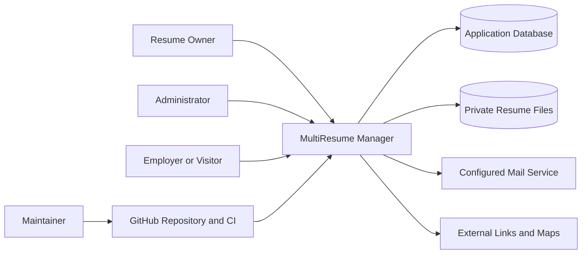
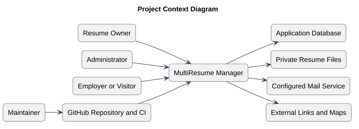

# Project Context

Status: Documented current implementation
Reviewed: 2026-10-06 (Europe/Berlin)
Source baseline: 0ca188f. This is documentation evidence, not production certification.

This context identifies the application boundary and its collaborators. The external-links edge represents navigation, not ingestion or synchronization. GitHub is a delivery dependency, not a runtime authentication provider.

Editable source: [project-context-diagram.mmd](diagrams/project-context-diagram.mmd).

## PlantUML view

This is a PlantUML rendering of the existing documented view. Read the accompanying document for the source references, constraints, and details omitted from this overview.

[Editable PlantUML source](diagrams/project-context-diagram.puml) · [Full-size diagram](diagrams/project-context-diagram.svg)
