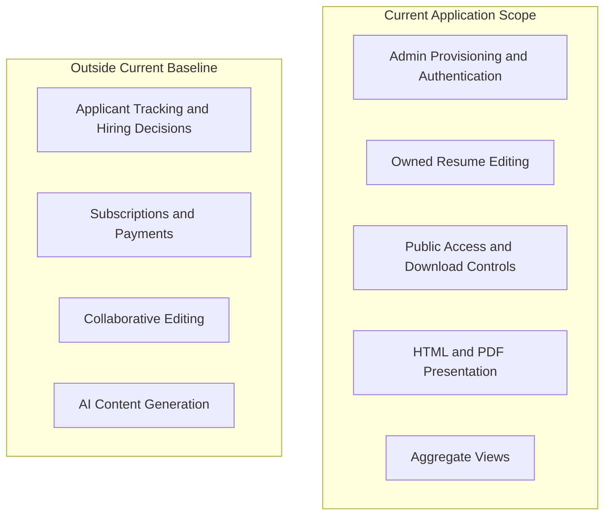

# Scope Boundary

Status: Documented current implementation
Reviewed: 2026-10-06 (Europe/Berlin)
Source baseline: 0ca188f. This is documentation evidence, not production certification.

The boundary separates delivered functionality from possible future products. Excluded items are not committed roadmap work. Altering the boundary requires requirement, risk and design review.

Editable source: [scope-boundary-diagram.mmd](diagrams/scope-boundary-diagram.mmd).

## PlantUML view

This is a PlantUML rendering of the existing documented view. Read the accompanying document for the source references, constraints, and details omitted from this overview.

[Editable PlantUML source](diagrams/scope-boundary-diagram.puml) · [Full-size diagram](diagrams/scope-boundary-diagram.svg)
