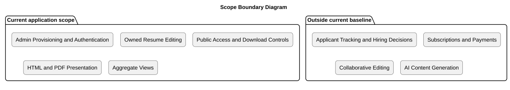

# Scope Boundary

Status: Documented current implementation
Reviewed: 2026-10-06 (Europe/Berlin)
Source baseline: 0ca188f. This is documentation evidence, not production certification.

The boundary separates delivered functionality from possible future products. Excluded items are not committed roadmap work. Altering the boundary requires requirement, risk and design review.

## PlantUML view

The diagram summarizes the documented view. The explanation above provides its context and limitations.

[Editable PlantUML source](diagrams/scope-boundary-diagram.puml) · [Full-size diagram](diagrams/scope-boundary-diagram.svg)
