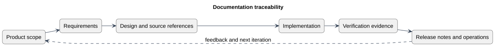

# Documentation traceability

Status: Documented view
Source baseline: 0aed931 (2026-10-06). Procedure diagrams describe the documentation workflow; they do not certify completed production actions.

## PlantUML view

Traceability connects intended behavior to implementation and evidence. The documentation folders organize responsibilities and do not require a rigid sequential lifecycle.

[Editable PlantUML source](diagrams/documentation-traceability.puml) · [Full-size diagram](diagrams/documentation-traceability.svg)
