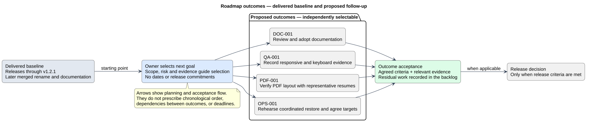

# Roadmap

Status: Documented baseline
Reviewed: 2026-10-06
Evidence baseline: local commit 0ca188f (merged project rename), with release history through v1.2.1.

## Delivered baseline

Releases through v1.2.1 include resume management, access/file safeguards, appearance improvements, evidence/demo links and improved date editing. The later project rename is merged at baseline commit 0ca188f and is not included in the existing v1.2.1 tag.

## Proposed next outcomes

1. Review and adopt this documentation baseline (DOC-001).
2. Record public/editor accessibility and responsive evidence (QA-001).
3. Validate PDF output and fix demonstrated layout problems (PDF-001).
4. Record recovery evidence and agree operational targets (OPS-001).

No dates, sprint numbers or new version numbers are committed here. Select work according to the next agreed goal, risk and available evidence. A roadmap outcome can require several iterations; a release happens only when its criteria are met.

## Visual roadmap

The diagram separates delivered capabilities from proposed outcomes. Each proposed outcome can be selected independently; the arrows explain selection and acceptance, not a fixed schedule or dependencies between DOC-001, QA-001, PDF-001 and OPS-001. Documentation publication does not by itself establish owner acceptance.

[Editable PlantUML source](diagrams/roadmap-outcomes.puml) · [Full-size diagram](diagrams/roadmap-outcomes.svg)

Use the [product backlog](product-backlog.md) for item details and acceptance evidence, and the [release records](../Releases/README.md) for delivered scope. This diagram summarizes the four proposed outcomes above; it does not create a second backlog.