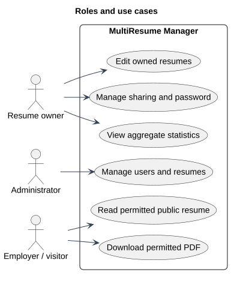

# Roles and use cases

Status: Documented view
Source baseline: 0aed931 (2026-10-06). Procedure diagrams describe the documentation workflow; they do not certify completed production actions.

## PlantUML view

Owners manage their own content; administrators manage accounts and resumes; visitors access only permitted public content. These are capabilities, not a claim that every role can use every route.

[Editable PlantUML source](diagrams/roles-and-use-cases.puml) · [Full-size diagram](diagrams/roles-and-use-cases.svg)
