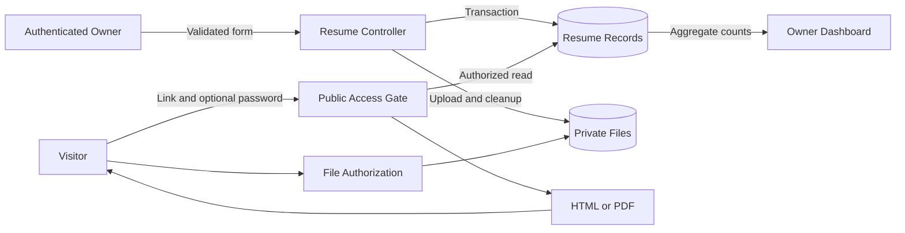

# Data Flow and Trust Boundaries

Status: Documented current implementation
Reviewed: 2026-10-06 (Europe/Berlin)
Source baseline: 0ca188f. This is documentation evidence, not production certification.

The private file boundary is distinct from record access. Counts are stored internally and not exposed as employer-facing analytics. Read authorization happens again on downloads/files; permission to read an HTML page is not a bypass for direct file paths.

Editable source: [data-flow-diagram.mmd](diagrams/data-flow-diagram.mmd).
