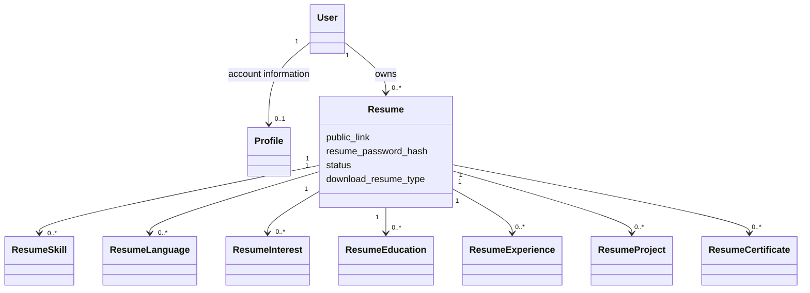
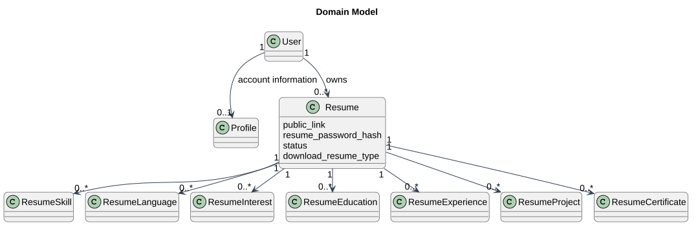

# Domain Model

Status: Documented current implementation
Reviewed: 2026-10-06 (Europe/Berlin)
Source baseline: 0ca188f. This is documentation evidence, not production certification.

Conceptual cardinalities follow model relationships. The optional Profile cardinality describes the application relationship, not a guarantee of a database uniqueness constraint. Per-resume personal data belongs to Resume and must not silently fall back to the account profile.

Editable source: [domain-model.mmd](diagrams/domain-model.mmd).

## PlantUML view

This is a PlantUML rendering of the existing documented view. Read the accompanying document for the source references, constraints, and details omitted from this overview.

[Editable PlantUML source](diagrams/domain-model.puml) · [Full-size diagram](diagrams/domain-model.svg)
