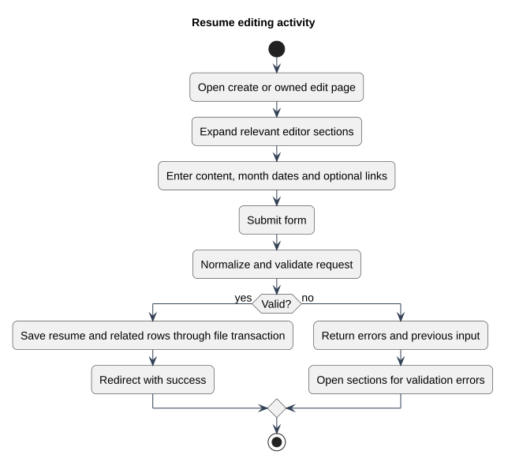

# Resume editing activity

Status: Documented view
Source baseline: 0aed931 (2026-10-06). Procedure diagrams describe the documentation workflow; they do not certify completed production actions.

## PlantUML view

Validation errors return the user to the form with previous input. The transaction sequence diagram explains database and file handling after successful validation.

[Editable PlantUML source](diagrams/resume-editing-activity.puml) · [Full-size diagram](diagrams/resume-editing-activity.svg)
