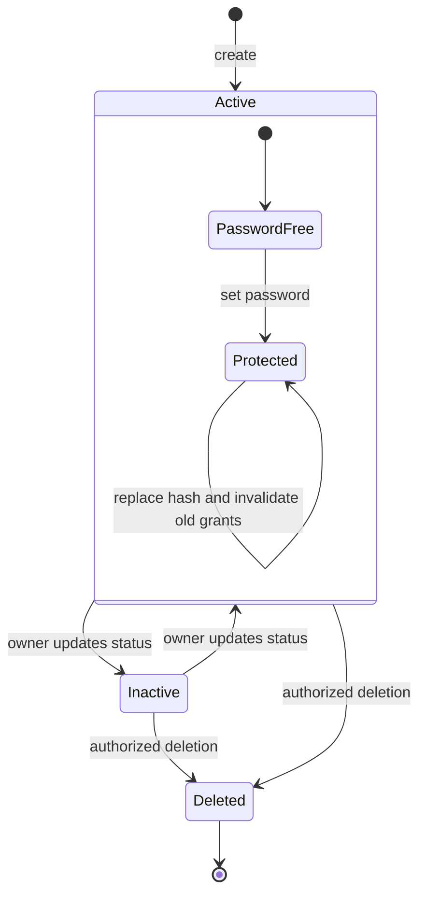

# Resume and Access States

Status: Documented current implementation
Reviewed: 2026-10-06 (Europe/Berlin)
Source baseline: 0ca188f. This is documentation evidence, not production certification.

The diagram records supported activation and password-setting concepts. It does not promise a dedicated password-removal operation. Visitor grants are session data, not a persistent Resume lifecycle state. Download mode and account status remain independent dimensions.

Editable source: [resume-state-diagram.mmd](diagrams/resume-state-diagram.mmd).
