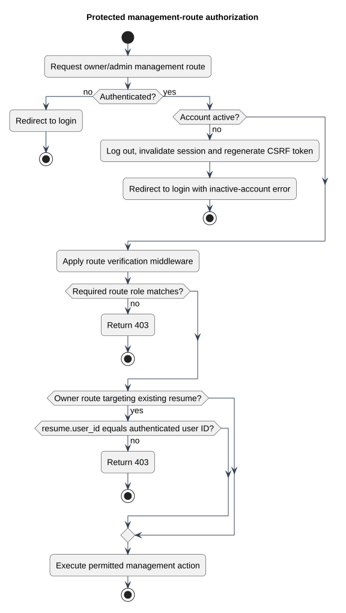

# Protected management-route authorization

Status: Documented implementation or operating procedure
Reviewed: 2026-10-06
Source baseline: 0175b95. A procedure diagram is not production certification.

This view covers protected user/admin management routes, not public links or the private-file route. Authentication, active-account checks, route middleware and controller ownership checks have distinct responsibilities. The verification middleware delegates to Laravel; this diagram does not claim every account implements an email-verification contract. Admin resume management is governed by admin routes, while user controllers check ownership.

[Editable PlantUML source](diagrams/authorization-decision-flow.puml) · [Full-size diagram](diagrams/authorization-decision-flow.svg)

## Evidence and related explanation

- [web.php](../../../application/routes/web.php)
- [app.php](../../../application/bootstrap/app.php)
- [EnsureAccountIsActive.php](../../../application/app/Http/Middleware/EnsureAccountIsActive.php)
- [UserMiddleware.php](../../../application/app/Http/Middleware/UserMiddleware.php)
- [ResumeController.php](../../../application/app/Http/Controllers/User/ResumeController.php)

See [the detailed explanation](authentication-and-authorization-design.md).
