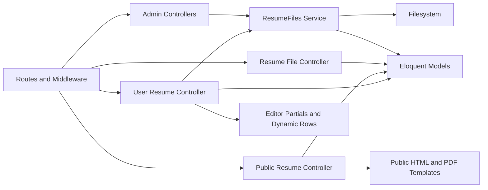

# Components and Responsibilities

Status: Documented current implementation
Reviewed: 2026-10-06 (Europe/Berlin)
Source baseline: 0ca188f. This is documentation evidence, not production certification.

Ownership/role decisions remain server-side. ResumeFiles owns transactional file coordination. Templates render data; browser JavaScript improves interactions but does not authorize requests. Account authentication uses Breeze-derived controllers and Laravel session behavior.

Editable source: [component-diagram.mmd](diagrams/component-diagram.mmd).
