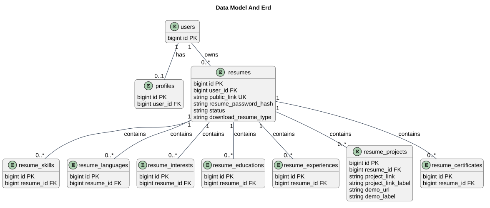

# Data Model and ERD

Status: Documented current implementation
Reviewed: 2026-10-06 (Europe/Berlin)
Source baseline: 0ca188f. This is documentation evidence, not production certification.

The ERD focuses on product entities and key relationships. Profile optionality describes model semantics and is not a substitute for schema uniqueness inspection. Framework infrastructure tables are cataloged separately. [Schema evidence](schema-reference.md) records migration operations, including later alterations; the initial create migration alone is not the final schema.

## PlantUML view

The diagram summarizes the documented view. The explanation above provides its context and limitations.

[Editable PlantUML source](diagrams/data-model-and-erd.puml) · [Full-size diagram](diagrams/data-model-and-erd.svg)
