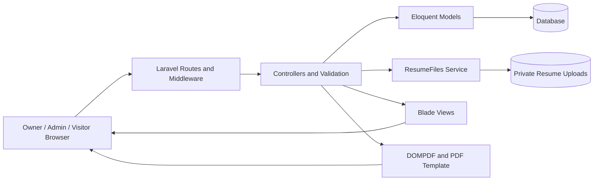

# Architecture and Data Model

Status: Documented baseline
Reviewed: 2026-10-06
Evidence baseline: local commit 0ca188f (merged project rename), with release history through v1.2.1.

The application is a server-rendered Laravel monolith using Blade, Tailwind CSS, Alpine.js and browser JavaScript. Vite produces frontend assets. Eloquent persists application data; the documented local database is MySQL. DOMPDF renders a separate Blade PDF template. PHPUnit uses isolated SQLite for automated tests.

Users have account profiles and many resumes. Each resume belongs to one user and has many skills, languages, interests, educations, experiences, projects and certificates. Personal resume fields are stored on the resume independently of the account profile. Framework session/cache/job tables are infrastructure, not additional resume sections.

The application key supports public access tokens and framework cryptography. Private files cross an authorization boundary through ResumeFileController; account profile photos have a separate public-storage policy. ResumeFiles coordinates database transactions and compensating file cleanup. This does not create a distributed atomic transaction across database and filesystem.

Appearance preferences are browser-local. Visual classes are not authorization controls. The public HTML view and PDF template are separate presentation paths and must both be checked when changing content.

## Detailed design

See the [design index](README.md) for architecture, components, ERD/schema, route contracts, authorization, file consistency, UI/PDF design and decision records. This overview remains a summary rather than a competing technical specification.
