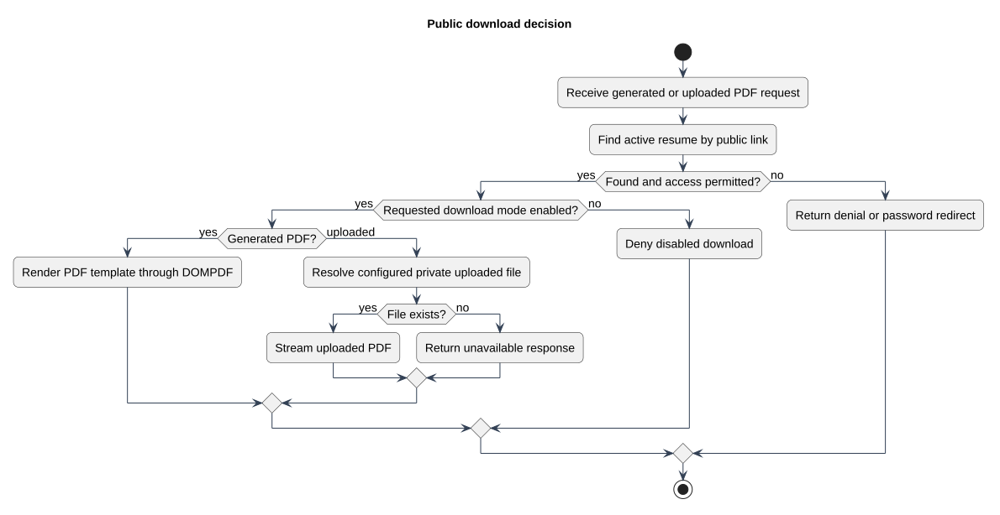

# Public download decision

Status: Documented view
Source baseline: 0aed931 (2026-10-06). Procedure diagrams describe the documentation workflow; they do not certify completed production actions.

## PlantUML view

Both download routes recheck public access and configured download mode. An existing public URL alone does not bypass the password or inactive state.

[Editable PlantUML source](diagrams/download-decision.puml) · [Full-size diagram](diagrams/download-decision.svg)
