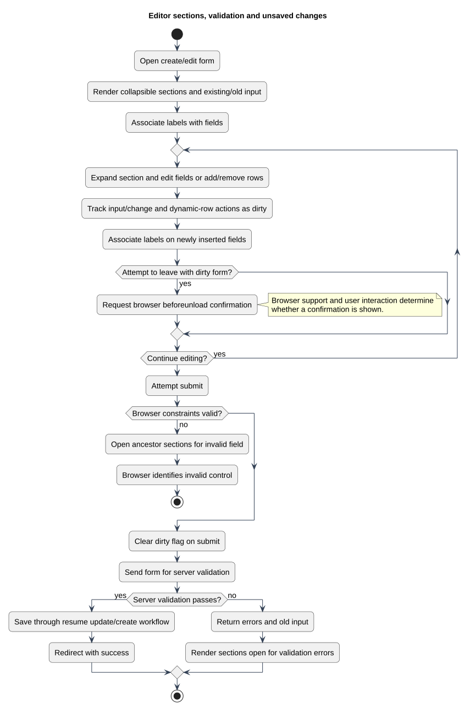

# Editor sections, validation and unsaved changes

Status: Documented implementation or operating procedure
Reviewed: 2026-10-06
Source baseline: 0175b95. A procedure diagram is not production certification.

The editor uses native details sections, repeatable rows, label association, browser constraint handling and server validation. Unsaved-change prompts are browser-managed; they are not autosave and do not guarantee data recovery. Dirty state is cleared on submission, so a network failure is not evidence that the form was saved. The existing resume editing activity describes persistence at a higher level; this diagram focuses on browser interactions.

[Editable PlantUML source](diagrams/editor-interaction-flow.puml) · [Full-size diagram](diagrams/editor-interaction-flow.svg)

## Evidence and related explanation

- [workspace.js](../../../application/resources/js/workspace.js)
- [create.blade.php](../../../application/resources/views/user/resumes/create.blade.php)
- [edit.blade.php](../../../application/resources/views/user/resumes/edit.blade.php)
- [form-scripts.blade.php](../../../application/resources/views/user/resumes/partials/form-scripts.blade.php)

See [the detailed explanation](ui-and-accessibility-design.md).
