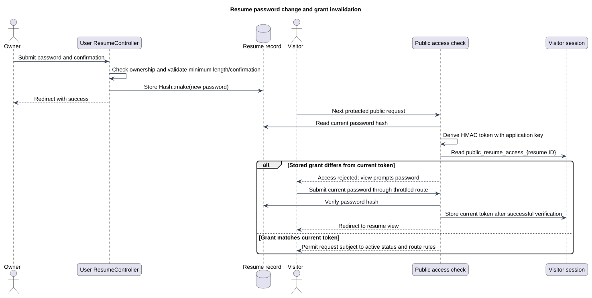

# Resume password change and grant invalidation

Status: Documented implementation or operating procedure
Reviewed: 2026-10-06
Source baseline: 0175b95. A procedure diagram is not production certification.

Changing the stored password hash changes the derived access token. Existing session grants are not proactively deleted from every visitor session: they become invalid when the next request compares the old token with the new one. The public view redirects to password entry; file requests can return 403. Failed password submissions do not create a grant. Application-key changes also affect the derived token.

[Editable PlantUML source](diagrams/password-change-sequence.puml) · [Full-size diagram](diagrams/password-change-sequence.svg)

## Evidence and related explanation

- [Resume.php](../../../application/app/Models/Resume.php)
- [ResumeController.php](../../../application/app/Http/Controllers/User/ResumeController.php)
- [PublicResumeController.php](../../../application/app/Http/Controllers/PublicResumeController.php)

See [the detailed explanation](authentication-and-authorization-design.md).
