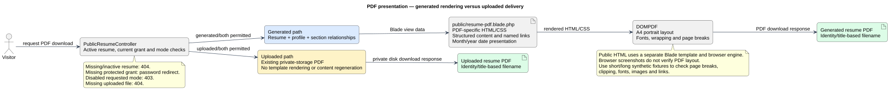

# PDF Rendering Design

Status: Documented current implementation
Reviewed: 2026-10-06 (Europe/Berlin)
Source baseline: 0ca188f. This is documentation evidence, not production certification.

DOMPDF loads resources/views/public/resume-pdf.blade.php and uses A4 portrait. The generated download independently verifies active resume, current grant and generated/both mode. Uploaded PDFs are delivered separately from private storage and preserve uploaded content. Both paths choose filenames from resume identity/title.

PDF content includes structured sections and named skill/project/demo links. Public HTML and PDF templates share data but not identical rendering engines or CSS support. Month/year formatting affects dates at presentation time; it does not repair stored years. Certificate issue dates remain date inputs in the editor.

Design goals are readable hierarchy, correct links, no clipped text, reasonable section/page breaks and consistent data. Those goals need long and short fixture rendering. Image availability, fonts, large descriptions and link wrapping can materially affect output. Browser CSS screenshots are not PDF evidence. Use isolated fixtures for rendering rather than publishing private resume samples.

Before altering fonts, remote-resource behavior or rendering limits inspect package configuration and operational resource needs. No broad claim of remote resource safety or tagged-PDF accessibility is made by this document.

## Visual rendering pipeline

The diagram focuses on presentation: generated PDFs pass through their own Blade template and DOMPDF, while uploaded PDFs are downloaded from private storage without regenerating their contents. The controller checks access and the requested download mode before either path proceeds.

[Editable PlantUML source](diagrams/pdf-rendering-pipeline.puml) · [Full-size diagram](diagrams/pdf-rendering-pipeline.svg)

The PDF template owns its styles, content layout and date/link presentation. DOMPDF produces the A4 portrait output; the browser-rendered public view is a separate presentation path. The diagram does not claim that all fonts, remote resources or fixtures have been verified.

### Source and related views

- [Public resume controller](../../../application/app/Http/Controllers/PublicResumeController.php)
- [Generated PDF template](../../../application/resources/views/public/resume-pdf.blade.php)
- [Download access decisions](download-decision.md)
- [Public HTML/PDF access sequence](public-access-sequence-diagram.md)