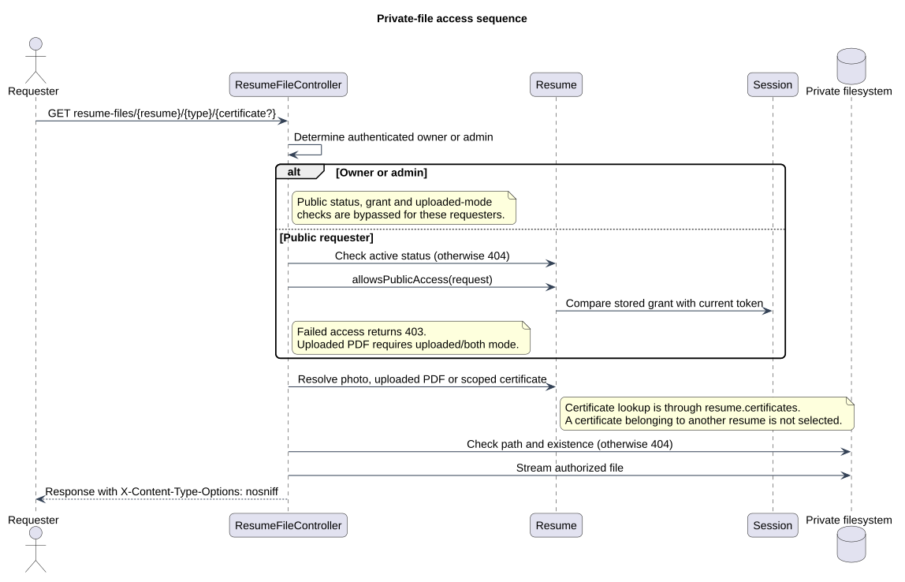

# Private-file access sequence

Status: Documented implementation or operating procedure
Reviewed: 2026-10-06
Source baseline: 0175b95. A procedure diagram is not production certification.

An authenticated owner or administrator can inspect resume files without public-access restrictions. Other requesters need an active resume and valid public access; uploaded PDFs additionally require an enabled uploaded-download mode. Denials terminate the request before the later operations shown. The general web active-account middleware also applies before the controller. File storage is private; possession of a path is not permission.

[Editable PlantUML source](diagrams/private-file-access-sequence.puml) · [Full-size diagram](diagrams/private-file-access-sequence.svg)

## Evidence and related explanation

- [ResumeFileController.php](../../../application/app/Http/Controllers/ResumeFileController.php)
- [Resume.php](../../../application/app/Models/Resume.php)
- [web.php](../../../application/routes/web.php)

See [the detailed explanation](file-storage-and-update-design.md).
