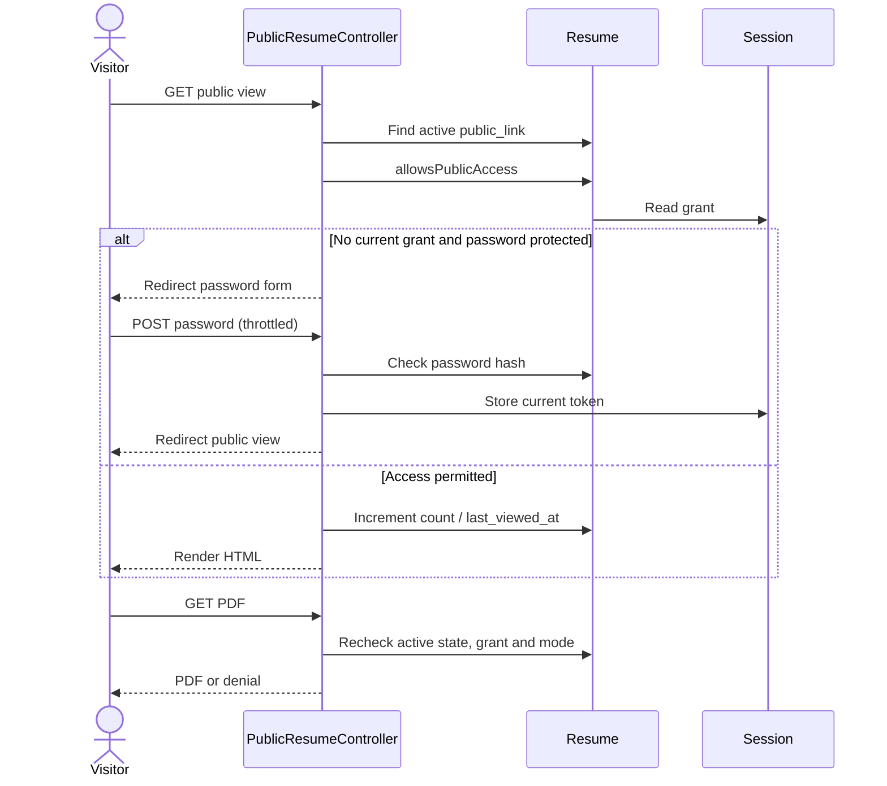
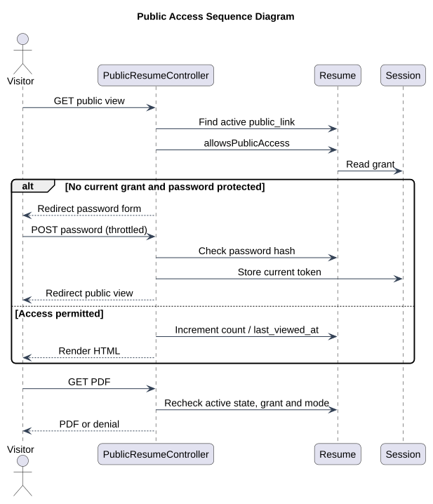

# Public Access Sequence

Status: Documented current implementation
Reviewed: 2026-10-06 (Europe/Berlin)
Source baseline: 0ca188f. This is documentation evidence, not production certification.

Separate requests recheck access. Incorrect passwords do not establish a grant. Uploaded/download file paths do not become publicly accessible merely because a visitor has previously seen HTML. See route contracts for redirect versus HTTP denial differences.

Editable source: [public-access-sequence-diagram.mmd](diagrams/public-access-sequence-diagram.mmd).

## PlantUML view

This is a PlantUML rendering of the existing documented view. Read the accompanying document for the source references, constraints, and details omitted from this overview.

[Editable PlantUML source](diagrams/public-access-sequence-diagram.puml) · [Full-size diagram](diagrams/public-access-sequence-diagram.svg)
