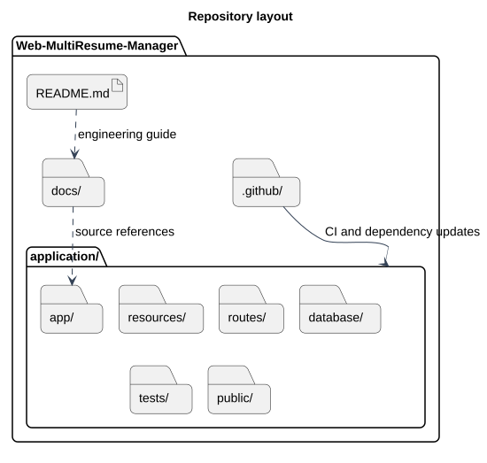

# Repository layout

Status: Documented view
Source baseline: 0aed931 (2026-10-06). Procedure diagrams describe the documentation workflow; they do not certify completed production actions.

## PlantUML view

Run Laravel, Composer and npm commands inside application/. The web server serves application/public/. Documentation remains separate at the repository root.

[Editable PlantUML source](diagrams/repository-layout.puml) · [Full-size diagram](diagrams/repository-layout.svg)
