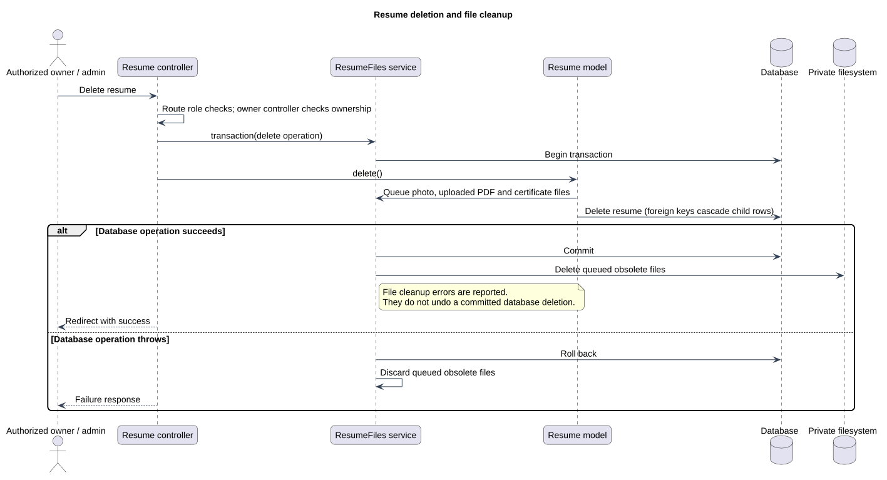

# Resume deletion and file cleanup

Status: Documented implementation or operating procedure
Reviewed: 2026-10-06
Source baseline: 0175b95. A procedure diagram is not production certification.

This sequence covers deleting a resume through the owner or administrator resume controller. The deleting model hook queues its file paths; child records are removed by schema foreign-key cascades. Cleanup happens after database commit. This is coordinated cleanup, not a distributed atomic transaction; failed file removal is reported and can require follow-up. Account deletion is a separate workflow.

[Editable PlantUML source](diagrams/resume-deletion-sequence.puml) · [Full-size diagram](diagrams/resume-deletion-sequence.svg)

## Evidence and related explanation

- [ResumeFiles.php](../../../application/app/Services/ResumeFiles.php)
- [Resume.php](../../../application/app/Models/Resume.php)
- [ResumeController.php](../../../application/app/Http/Controllers/User/ResumeController.php)
- [ResumeController.php](../../../application/app/Http/Controllers/Admin/ResumeController.php)
- [migrations](../../../application/database/migrations)

See [the detailed explanation](file-storage-and-update-design.md).
