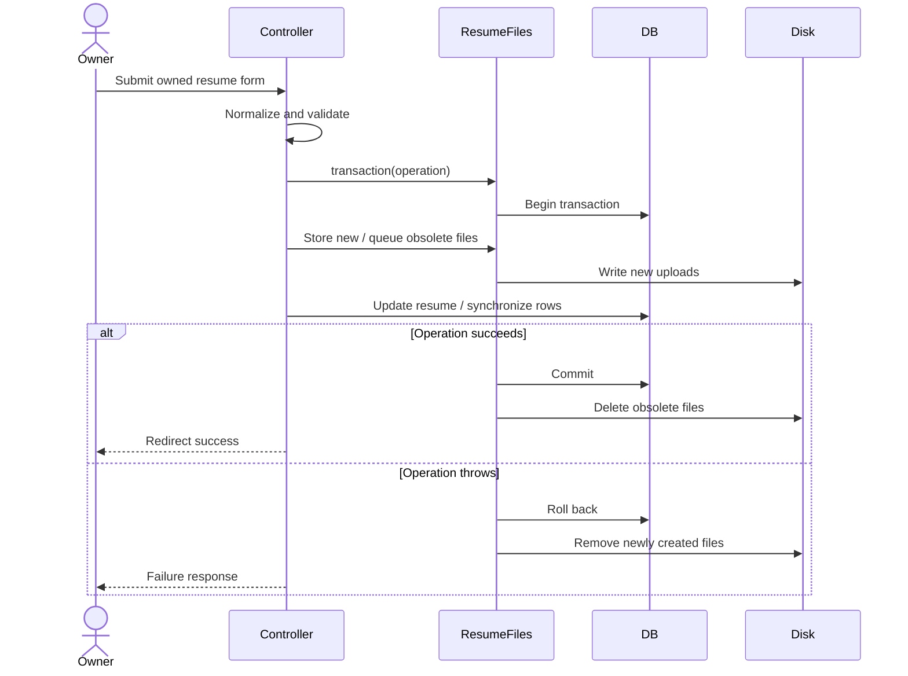

# Resume Update Sequence

Status: Documented current implementation
Reviewed: 2026-10-06 (Europe/Berlin)
Source baseline: 0ca188f. This is documentation evidence, not production certification.

The transaction wrapper compensates filesystem changes, with reported cleanup failures. Exact controller exceptions may use Laravel’s error handling; the diagram does not promise that every storage failure has a custom friendly form message.

Editable source: [resume-update-sequence-diagram.mmd](diagrams/resume-update-sequence-diagram.mmd).
