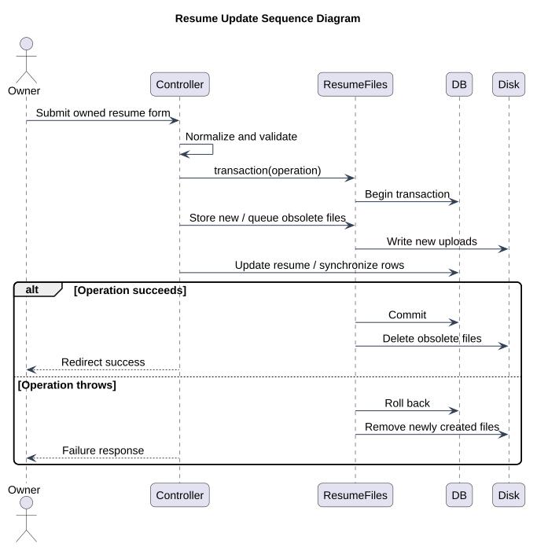

# Resume Update Sequence

Status: Documented current implementation
Reviewed: 2026-10-06 (Europe/Berlin)
Source baseline: 0ca188f. This is documentation evidence, not production certification.

The transaction wrapper compensates filesystem changes, with reported cleanup failures. Exact controller exceptions may use Laravel’s error handling; the diagram does not promise that every storage failure has a custom friendly form message.

## PlantUML view

The diagram summarizes the documented view. The explanation above provides its context and limitations.

[Editable PlantUML source](diagrams/resume-update-sequence-diagram.puml) · [Full-size diagram](diagrams/resume-update-sequence-diagram.svg)
