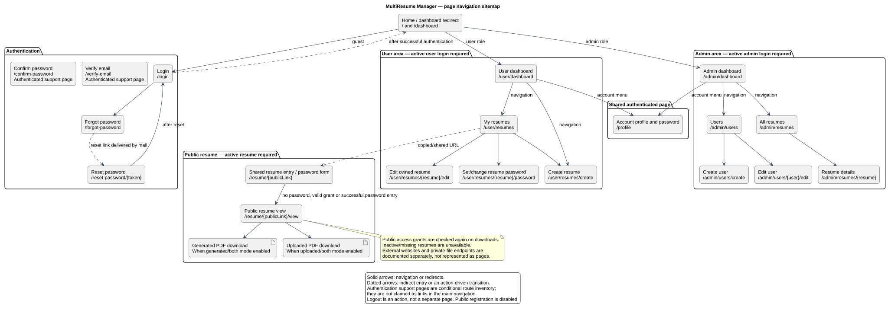

# Page navigation sitemap

Status: Documented current implementation
Reviewed: 2026-10-06
Source baseline: 40236ff. Navigation and route inventory, not a claim of production verification.

This map groups the pages into authentication, user, administrator and public areas. The account profile is shared by authenticated roles. Solid arrows show navigation or redirects; dotted arrows represent indirect entry, such as an emailed reset link or a copied resume URL. The map shows main paths rather than every possible return link.

[Editable PlantUML source](diagrams/site-map.puml) · [Full-size diagram](diagrams/site-map.svg)

## Access and navigation notes

- User and admin management routes require authentication, the appropriate role, and the applicable middleware checks. User resume actions additionally check ownership.
- Public registration is disabled. Administrators create user accounts.
- Email verification and password confirmation are defined support routes, not ordinary top-level navigation destinations. Their use depends on Laravel authentication behavior and the invoked action.
- The public resume entry redirects to the view when access is allowed. Protected resumes require a current session grant or successful password entry; inactive or missing resumes are unavailable.
- PDF downloads are terminal actions, shown to clarify the visitor journey. Their exact URLs and gates are in the route reference.
- Profile editing includes account-password controls. Logout, deletion, file serving and form submissions are actions/endpoints rather than separate pages.

## Source references

- [Web routes](../../../application/routes/web.php)
- [Authentication routes](../../../application/routes/auth.php)
- [Role-aware navigation](../../../application/resources/views/layouts/navigation.blade.php)
- [Resume list and sharing controls](../../../application/resources/views/user/resumes/index.blade.php)
- [Public resume and downloads](../../../application/resources/views/public/resume-view.blade.php)

See [route contracts](route-and-request-contracts.md) for methods and detailed access requirements, and [authorization decisions](authorization-decision-flow.md) for protected management-route checks.