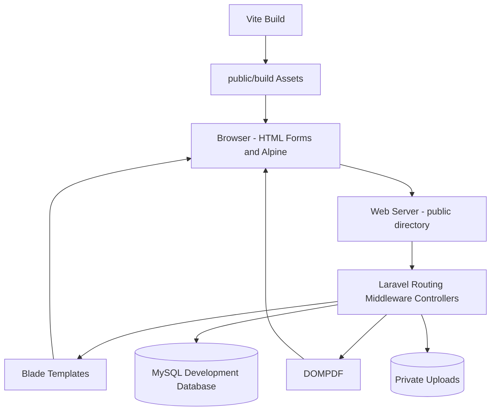
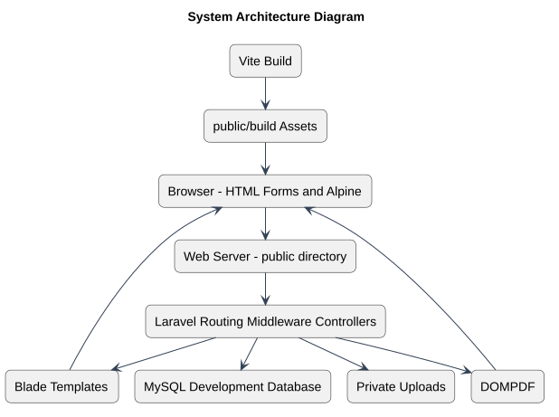

# System Architecture

Status: Documented current implementation
Reviewed: 2026-10-06 (Europe/Berlin)
Source baseline: 0ca188f. This is documentation evidence, not production certification.

This is a monolith with server-rendered forms, not OmniDesk’s React/REST provider architecture. MySQL reflects the documented development environment; tests use SQLite. Web-server and PHP-FPM production choices are deployment configuration rather than verified infrastructure inventory.

Editable source: [system-architecture-diagram.mmd](diagrams/system-architecture-diagram.mmd).

## PlantUML view

This is a PlantUML rendering of the existing documented view. Read the accompanying document for the source references, constraints, and details omitted from this overview.

[Editable PlantUML source](diagrams/system-architecture-diagram.puml) · [Full-size diagram](diagrams/system-architecture-diagram.svg)
