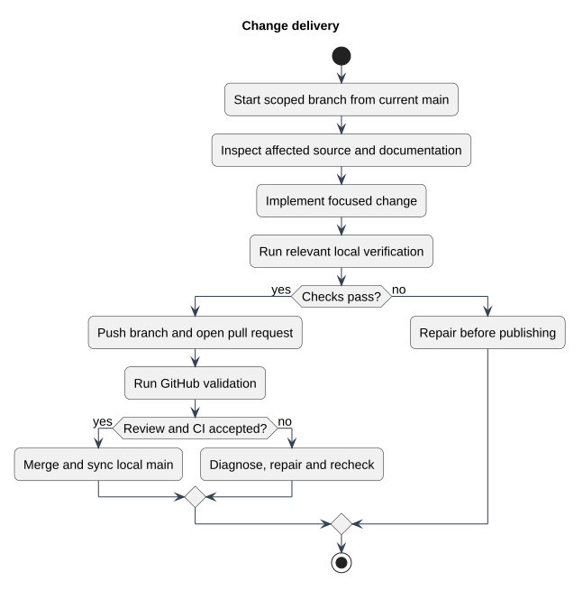

# Development Workflow

Status: Documented current implementation
Reviewed: 2026-10-06 (Europe/Berlin)
Source baseline: 0ca188f. This is documentation evidence, not production certification.

## Visual workflow

This PlantUML overview summarizes local implementation, verification, pull-request review and integration. Use the numbered steps below for the detailed checks. Review and CI failures require repair and rechecking before acceptance; the diagram is a summary, not an automatic merge policy. Verify the resulting main branch before a release tag is created.

[Editable PlantUML source](diagrams/change-delivery.puml) · [Full-size diagram](diagrams/change-delivery.svg) · [Change-delivery explanation](change-delivery.md)

## Detailed steps
1. Start from a known branch/commit, inspect git status, and preserve unrelated changes.
2. Link the requested outcome to requirements/backlog and agree acceptance boundaries.
3. Read routes, validation, persistence and templates relevant to the behavior.
4. Make the smallest coherent change; keep static/dynamic field generation aligned.
5. Run affected regression checks, then proportionate build/full-suite checks.
6. Review source, migrations, links, escaping and generated-file noise.
7. Update authoritative docs and record limitations.
8. Integrate through review; verify main before tagging.

Use schema migrations for additive data changes, do not reset a live/development database for a routine feature, and preserve current file access semantics. Keep PHP/JS package metadata and lockfiles consistent. Record relevant commands and exit status; do not reuse older evidence as a current result.

Public/PDF changes need both templates; editor changes need both create/edit and dynamic rows. Access changes need negative tests for guest, owner, other user and administrator. Database-engine locking/transaction behavior can differ from SQLite tests and warrants environment-specific evidence for concurrency changes.
