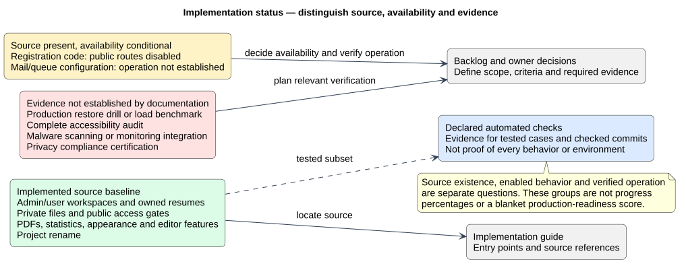

# Implementation Status and Evidence Boundaries

Status: Documented current implementation
Reviewed: 2026-10-06 (Europe/Berlin)
Source baseline: 0ca188f. This is documentation evidence, not production certification.

## Visual status and evidence map

The groups below distinguish implemented source, conditional availability, automated-check evidence and verification that has not been established. They are categories rather than completion percentages. Follow the detailed notes below for the important qualifications.

[Editable PlantUML source](diagrams/implementation-evidence-map.puml) · [Full-size diagram](diagrams/implementation-evidence-map.svg) · [Proposed follow-up work](../../Project-Management/product-backlog.md)
## Delivered source baseline

Current main contains administrator/user workspaces; owned structured resumes; private resume uploads and authorization gates; public password/session access; PDFs and aggregate statistics; Light/Dark/System appearance; evidence/demo labels; month editing; collapsible sections; and the project rename. Relevant entry points are in [implementation guide](implementation.md).

## Source exists versus feature enabled

Registration controllers/templates remain in the repository while public routes are disabled. A source file’s existence does not make a workflow available. Queues/mail/infrastructure configuration files are framework capabilities, not proof of an operational background workload or working mail provider. Existing tests cover declared cases, not all future changes.

## Evidence not claimed

No production restore exercise, load benchmark, complete accessibility audit, malware scanning, monitoring integration or privacy compliance certification has been established by this documentation task. These boundaries are tracked as proposed work or owner decisions. The rename follows v1.2.1 and should not be retrospectively included in that tag’s delivered scope.
