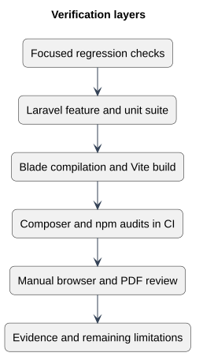

# Verification layers

Status: Documented view
Source baseline: 0aed931 (2026-10-06). Procedure diagrams describe the documentation workflow; they do not certify completed production actions.

## PlantUML view

Automation establishes tested behavior. Manual review covers layout, keyboard interaction and representative public/PDF journeys; passing CI is not production certification.

[Editable PlantUML source](diagrams/verification-layers.puml) · [Full-size diagram](diagrams/verification-layers.svg)
