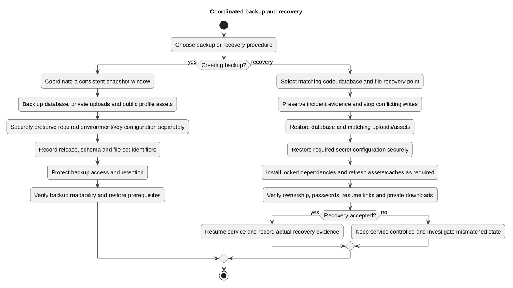

# Coordinated backup and recovery

Status: Documented implementation or operating procedure
Reviewed: 2026-10-06
Source baseline: 0175b95. A procedure diagram is not production certification.

This is a visual guide to the backup/recovery runbook, not evidence that a production restore drill has passed. A database snapshot and file set must belong to the same recovery point. Preserve the required application key through secure secret handling. Owners must determine retention, access, recovery-time and recovery-point objectives for their deployment.

[Editable PlantUML source](diagrams/backup-recovery-activity.puml) · [Full-size diagram](diagrams/backup-recovery-activity.svg)

## Evidence and related explanation

- [backup-and-recovery-runbook.md](backup-and-recovery-runbook.md)

See [the detailed explanation](backup-and-recovery-runbook.md).
