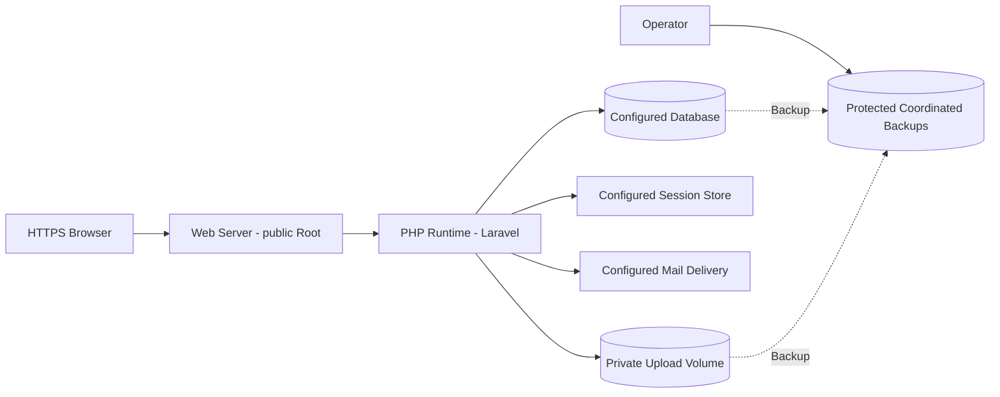

# Deployment Boundaries

Status: Documented current implementation
Reviewed: 2026-10-06 (Europe/Berlin)
Source baseline: 0ca188f. This is documentation evidence, not production certification.

This is a deployment design boundary, not an assertion that a particular production machine has these controls configured. TLS, runtime/storage permissions, session persistence, mail and protected recovery must be verified in the chosen environment.

Editable source: [deployment-architecture.mmd](diagrams/deployment-architecture.mmd).
