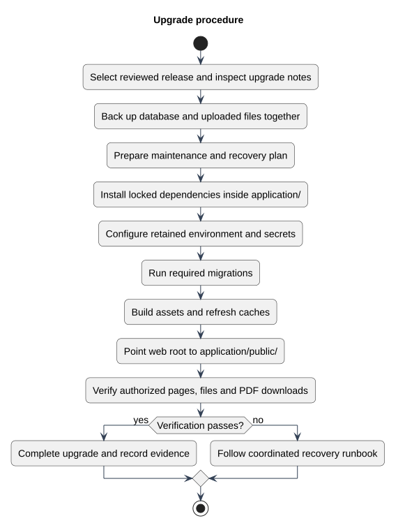

# Upgrade procedure

Status: Documented view
Source baseline: 0aed931 (2026-10-06). Procedure diagrams describe the documentation workflow; they do not certify completed production actions.

## PlantUML view

This illustrates the deployment runbook. Migration rollback and database/file restoration require release-specific decisions; changing code alone may not restore schema or uploads.

[Editable PlantUML source](diagrams/upgrade-activity.puml) · [Full-size diagram](diagrams/upgrade-activity.svg)
