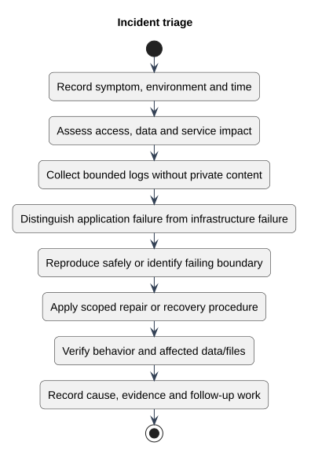

# Incident triage

Status: Documented view
Source baseline: 0aed931 (2026-10-06). Procedure diagrams describe the documentation workflow; they do not certify completed production actions.

## PlantUML view

Use the maintenance runbooks for concrete commands and escalation decisions. Keep passwords, resume contents and personal details out of incident records.

[Editable PlantUML source](diagrams/incident-triage.puml) · [Full-size diagram](diagrams/incident-triage.svg)
